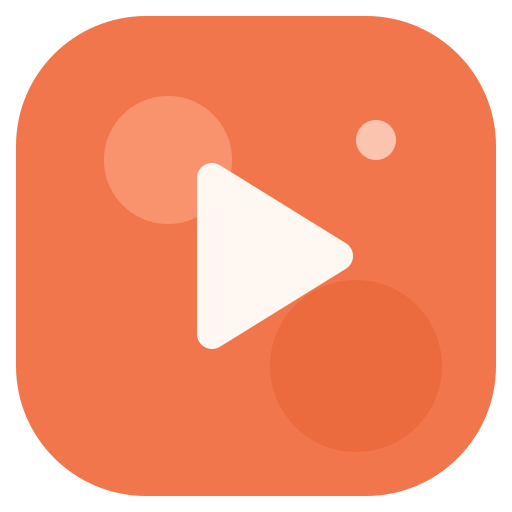

# studio_saba
با چند کلیک محتوا بسازید

# استودیو صبا

**از یک موضوع ساده تا پرامپت کامل ویدئوی انیمیشنی اینستاگرام، در چند دقیقه**

  

[دانلود آخرین نسخه](../../releases/latest) · [خرید اشتراک](https://ble.ir/virolicensebot?start=sabastudio) · [حمایت از سازنده](https://ble.ir/virolicensebot?start=donate)

## استودیو صبا چیست؟

استودیو صبا یک برنامهٔ فارسی و راست‌به‌چپ برای تولیدکنندگان محتواست. موضوع را می‌دهید، سبک و رنگ را انتخاب می‌کنید و برنامه برای هر صحنه **پرامپت تصویر** و **پرامپت انیمیشن** آماده می‌سازد؛ آمادهٔ استفاده در ابزارهای ساخت تصویر و ویدئو.

مسیر ساخت: موضوع ← سبک بصری ← نسبت تصویر ← عنوان ← استوری‌بورد ← پیش‌نمایش و خروجی

## امکانات

- **پیشنهاد موضوع با هوش مصنوعی**، بدون ایدهٔ تکراری
- **بیش از ۲۵ دستهٔ محتوایی** (آموزش، سلامت، بیمه و…) و دستهٔ سفارشی
- **۱۱ سبک بصری**: مینیمال هندسی، نئون شبانه، خمیری پاستیلی، کاغذ و مقوا، تایپوگرافی جسورانه، فلت عمومی، فلت گرم آویرا و سه سبک آویرا کر
- **پالت‌های رنگی آماده** و **۱۲ افکت تیتر** با پنج سطح شدت
- **استوری‌بورد هوشمند**: متن، توضیح تصویر، تیتر و نریشن برای هر صحنه، با هوک‌ها و قالب‌های روایت آماده
- **پرامپت image-to-video لایه‌ای**، تا مدل ویدئو تصویر مرجع را از نو نسازد
- **استودیوی صدا**: تبدیل نریشن به گفتار
- **برندکیت**: سبک، رنگ و قوانین برند را یک بار تعریف کنید و روی همهٔ ویدئوها اعمال کنید
- **پروژه‌ها**: ذخیرهٔ خودکار، کپی، حذف و پشتیبان JSON و Markdown
- **۱۶ تم رنگی** روشن و تیره

## حریم خصوصی

- همه‌چیز روی دستگاه خود شما می‌ماند: پروژه‌ها، برندکیت‌ها و کلیدهای هوش مصنوعی.
- برنامه سرور واسط ندارد؛ درخواست‌ها مستقیم از دستگاه شما به سرویس هوش مصنوعی انتخابی‌تان می‌رود.
- **کلید شخصی (BYOK)**: OpenAI، Google Gemini، OpenRouter، 9Router یا هر سرویس سازگار با OpenAI.

## دانلود و نصب

از بخش [Releases](../../releases/latest) یکی را بگیرید:

| فایل | توضیح |
|---|---|
| `SabaStudio-0.3.0-setup.exe` | نصب‌کننده (پیشنهادی)، حدود ۲٫۸ مگابایت |
| `SabaStudio-0.3.0-portable.exe` | نسخهٔ قابل‌حمل بدون نصب، حدود ۶٫۵ مگابایت |

**نیازمندی‌ها:** ویندوز ۱۰ یا ۱۱ (WebView2 روی این ویندوزها از قبل نصب است).

> اگر ویندوز پیام SmartScreen نشان داد، روی **More info** و بعد **Run anyway** بزنید. این پیام برای برنامه‌های تازه منتشرشده طبیعی است.

## لایسنس و خرید

- بعد از نصب می‌توانید **دورهٔ آزمایشی رایگان** را شروع کنید.
- برای ادامه، اشتراک را از [بازوی بله](https://ble.ir/virolicensebot?start=sabastudio) بخرید و کلید لایسنس را در برنامه وارد کنید.
- برای انتقال به دستگاه دیگر: تنظیمات ← لایسنس و حمایت ← غیرفعال‌کردن این دستگاه.

## پشتیبانی

سؤال یا مشکل دارید؟ در بخش [Issues](../../issues) بنویسید یا از طریق [بازوی بله](https://ble.ir/virolicensebot) پیام بدهید.

اگر استودیو صبا به کارتان آمد، [از سازنده حمایت کنید](https://ble.ir/virolicensebot?start=donate) 🧡

---

© ۲۰۲۶ سید صبا میری · همهٔ حقوق محفوظ است. این مخزن فقط برای انتشار نسخه‌هاست و کد منبع در آن قرار ندارد.

